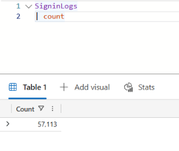
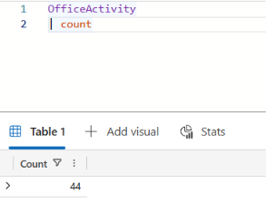

# Detection Engineering Portfolio

I am building KQL detection rules for attacks on cloud accounts and measuring how well they work. This is a personal learning project. The company, employees and attacks are all fictional, and no real personal data is used.

The rules run on an Azure Data Explorer free cluster. KQL is the same query language used in Microsoft Sentinel, but this project does not run on Sentinel.

## Status

- [x] Free Azure Data Explorer cluster and private repository
- [x] Synthetic sign-in and mailbox logs with four planted attacks
- [x] Logs loaded into Azure Data Explorer and row counts checked
- [ ] Detection rule for password spraying
- [ ] Detection rule for impossible travel
- [ ] Detection rule for MFA fatigue
- [ ] Detection rule for suspicious inbox forwarding
- [ ] Measure each rule against the answer key (precision and recall)
- [ ] Add one or two rules on real public attack logs
- [ ] Add an OT / power-grid security section

## Day 1 (5 November 2026)

Today I set up the project and built the data.

I generated logs for 1,000 fictional employees over 30 days in September 2026. I planted password spraying, impossible travel, MFA fatigue and a suspicious inbox forwarding rule. I also added normal VPN sign-ins and normal inbox rules, because a rule should be tested on activity that only looks suspicious.

The answer key stays on my own computer and is not in this repository, so each rule has to find the attacks from behaviour alone.

After loading the data, I compared the row counts with the source files: 57,113 sign-ins and 44 mailbox events.

## Repository

- `notebooks/`: the notebook that generates the synthetic data
- `data/`: the sign-in and mailbox logs
- `detections/`: KQL rules, added as they are written
- `docs/screenshots/`: screenshots from Azure Data Explorer

## Limits

The data is synthetic and simpler than real logs. Good results here show the method, not how the rules would perform in a real company.

## Tools

Python, pandas, NumPy, KQL, Azure Data Explorer, Git, GitHub
