# Detection Engineering Portfolio

I am building KQL detection rules for attacks on cloud accounts and measuring how well they work. This is a personal learning project. The company, employees and attacks are all fictional, and no real personal data is used.

The rules run on an Azure Data Explorer free cluster. KQL is the same query language used in Microsoft Sentinel, but this project does not run on Sentinel.

## Status

- [x] Free Azure Data Explorer cluster and private repository
- [x] Synthetic sign-in and mailbox logs with four planted attacks
- [x] Logs loaded into Azure Data Explorer and row counts checked
- [x] Detection rule for password spraying
- [x] Detection rule for impossible travel
- [x] Detection rule for MFA fatigue
- [x] Detection rule for suspicious inbox forwarding
- [x] Measure each rule against the answer key (precision and recall)
- [ ] Add one or two rules on real public attack logs
- [ ] Add an OT / power-grid security section

## Day 1 (5 November 2026)

Today I set up the project and built the data.

I generated logs for 1,000 fictional employees over 30 days in September 2026. I planted password spraying, impossible travel, MFA fatigue and a suspicious inbox forwarding rule. I also added normal VPN sign-ins and normal inbox rules, because a rule should be tested on activity that only looks suspicious.

The answer key stays on my own computer and is not in this repository, so each rule has to find the attacks from behaviour alone.

After loading the data, I compared the row counts with the source files: 57,113 sign-ins and 44 mailbox events.

## Day 2 (6 November 2026)

### Password spraying

Password spraying (MITRE ATT&CK T1110.003) means trying one or a few common passwords against many accounts, once each. It is designed to avoid account lockout, because no single account fails often enough to be locked.

My first attempt simply counted failed sign-ins (ResultType 50126) per IP. It did not work well. The four office IPs ranked above the attacker, because 1,000 employees mistype their passwords now and then over a month.

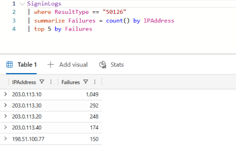

Next I counted how many different accounts each IP failed on within one hour. With a threshold of 20, only the attacker was left: 150 different accounts in one hour.

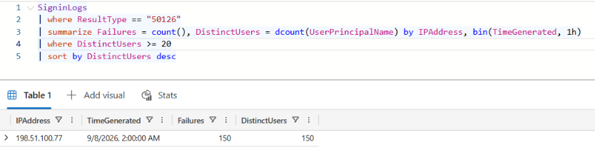

Before trusting that threshold, I checked how close normal traffic came to it. The busiest office hour in Oslo reached 15 accounts, which felt too close to 20.

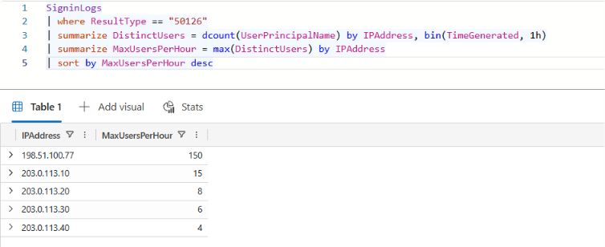

Raising the threshold would hide slower attackers, so I added a second condition instead: almost no successful sign-ins from that IP in the same hour. Office hours had about 94% success, while the attacker had none. With both conditions I could lower the threshold to 10 and still get only the attack.

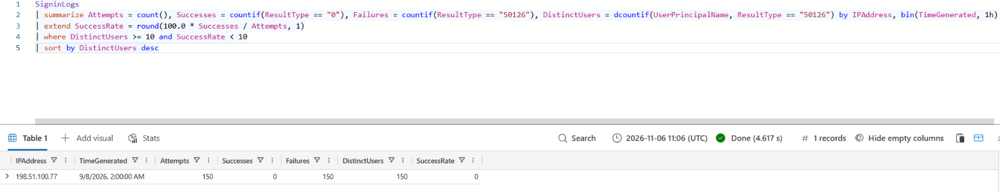

To check that the second condition really matters, I removed it. The same threshold then returned 17 alerts, and 16 of them were normal morning sign-ins at the Oslo office.

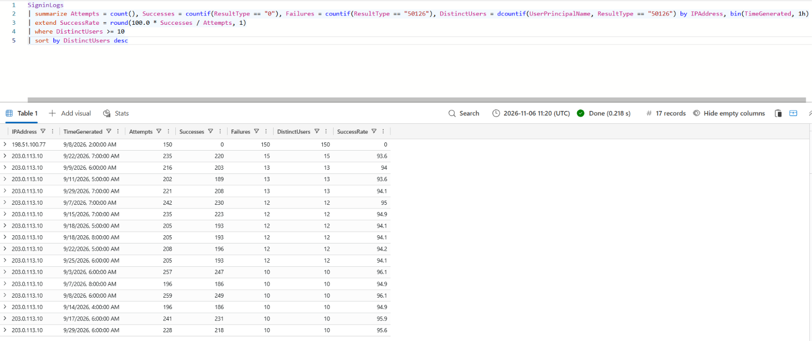

The rule is in `detections/password_spraying.kql`.

### Impossible travel

Impossible travel (MITRE ATT&CK T1078.004) means the same account signs in from two places that are too far apart for the time between them. It usually means someone else has the password, so this rule only looks at successful sign-ins.

The logs only have city names, so I added a small table with approximate coordinates for each city. For every user, I compared each successful sign-in with the previous one and calculated the distance and the implied travel speed.

The fastest "trip" was not an attack. It was a normal user who signed in through the company VPN in Frankfurt and then from Oslo one minute later, which looks like 54,900 km/h. Three more VPN users also showed up among the top ten.

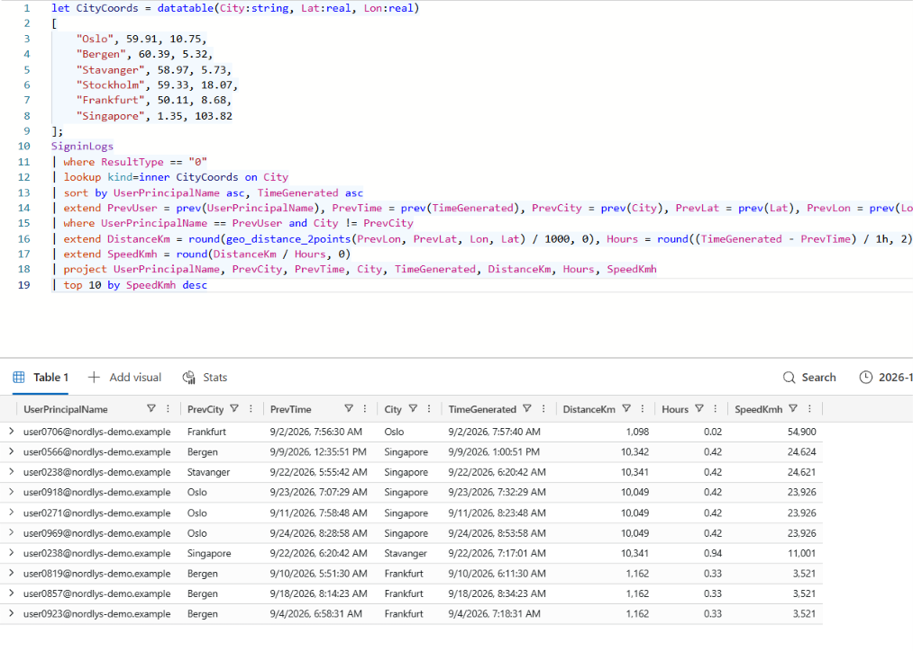

A company knows its own VPN addresses, so I excluded the VPN IP and kept only trips faster than 900 km/h, roughly the speed of a passenger plane. That left six rows: five sign-ins from Singapore about 25 minutes after a sign-in in Norway, and one return trip when the real user signed in again in Stavanger.

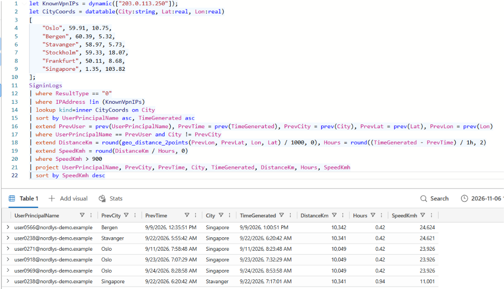

One attack should give one alert, so I grouped the results into one alert per user per day. The final rule returns five alerts for five attacks. The Legs column shows that one of them had two parts: the trip to Singapore and the trip back.

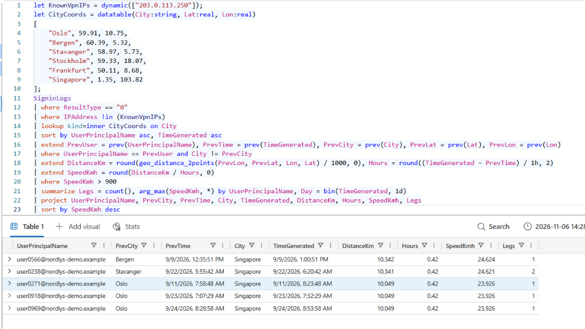

The rule is in `detections/impossible_travel.kql`.

Both rule files include notes on the logic, thresholds, known false positives and limits. Precision and recall against the answer key will come once all four rules are written.

## Day 3 (9 November 2026)

### MFA fatigue

MFA fatigue (MITRE ATT&CK T1621, Multi-Factor Authentication Request Generation) means an attacker who already has a password keeps triggering MFA prompts on the user's phone until the user approves one, often just to make the prompts stop.

In the logs, an MFA prompt that is not completed has ResultType 500121, and a successful sign-in has ResultType 0. I first listed every user with 500121 failures. Only three users had any, all from one IP in Frankfurt, with 17, 15 and 12 failures.

That result is too clean. In a real company, normal users also fail MFA prompts now and then, for example when their phone is not at hand. My synthetic data has no normal MFA failures, so I wrote the rule for real conditions rather than only for this data.

The rule has two severity levels. A burst of 5 or more failures for the same user and IP, followed by a successful sign-in from the same IP within 30 minutes, is High, because the user most likely approved a prompt. A burst with no success afterwards is Medium, because the attack is still going on or has failed.

My first version grouped failures into fixed one-hour windows. It returned four alerts for three attacks, because one attack crossed the top of the hour and was split in two. I replaced the fixed windows with session windows: failures stay in the same burst as long as the gap between them is under 15 minutes. The final rule returns three alerts for three attacks, all High. In each case the successful sign-in came within one minute of the last failed prompt.

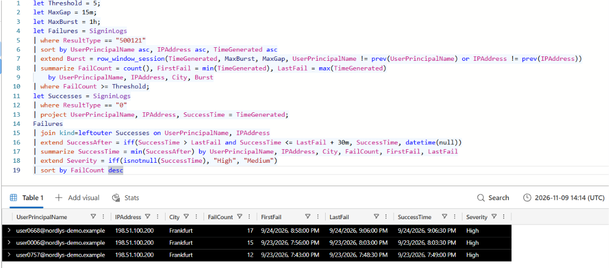

The Medium level was not triggered in this data, so it is still untested.

The rule is in `detections/mfa_fatigue.kql`.

### Suspicious inbox forwarding

An inbox forwarding rule (MITRE ATT&CK T1114.003, Email Collection: Email Forwarding Rule) sends copies of a user's mail to another address. Attackers like it because the rule keeps working even after the stolen password is changed.

The mailbox log has 44 new inbox rules. 31 do not forward at all, 9 forward to addresses inside the company domain, and 4 forward to an outside domain. Like the MFA data, this is too clean: no normal rule forwards outside the company, while in a real company some people forward work mail to a personal address.

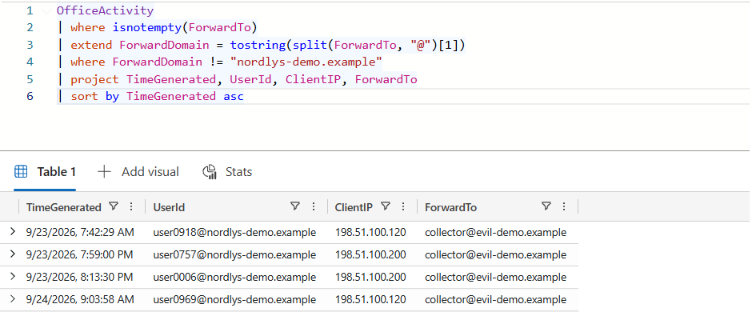

The four external rules came from the same two IPs used in the impossible travel and MFA fatigue attacks. To check this, I joined the mailbox log with the sign-in log on user and IP. Each rule was created 10 minutes after a sign-in by the same user from the same IP, so the forwarding rules are the next step of attacks the other rules already found. The fixed 10-minute gap comes from how I generated the data; real attackers are less regular. Only four of the eight compromised accounts got a forwarding rule, so this rule also has to work on its own.

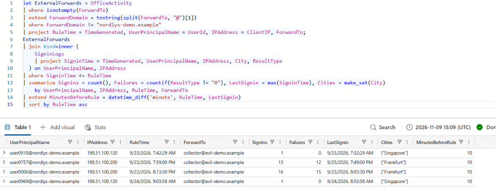

Companies have different policies, so the rule has a switch, ExternalForwardingAllowed. If external forwarding is not allowed, every external forwarding rule is High. If it is allowed, a rule created from a known office or VPN IP is Medium, and a rule from any other IP is High. For this fictional company the switch is off, and the rule returns four alerts for four planted rules, all High.

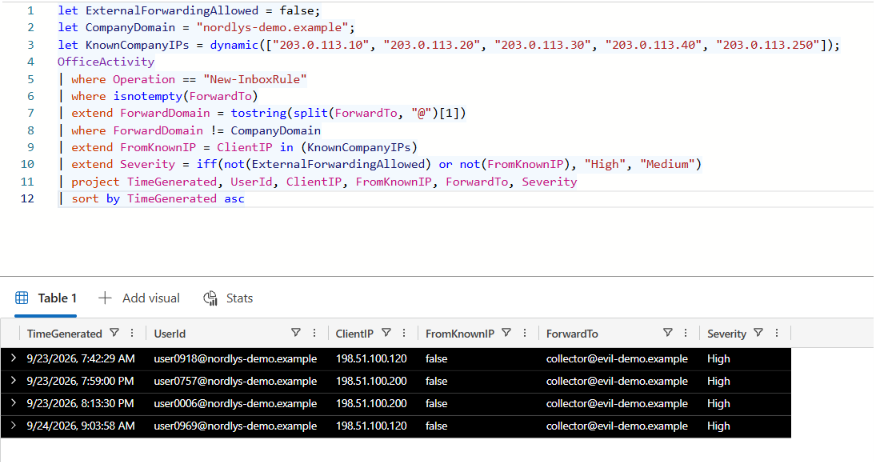

The rule is in `detections/inbox_forwarding.kql`.

### Measuring the rules against the answer key

The KQL rules found the attacks on Azure Data Explorer from behaviour alone. The answer key lists every planted attack with its type. It was never loaded into the cluster, so the rules could not use it. I kept it on my own computer and compared it with the rule results in PowerShell.

I counted incidents, not rows. For example, one password spraying attack from one IP is one incident, even though it touched 150 accounts.

| Rule | Planted incidents | Alerts | True positives | False positives | Missed | Precision | Recall |
|---|---|---|---|---|---|---|---|
| Password spraying | 1 | 1 | 1 | 0 | 0 | 100% | 100% |
| Impossible travel | 5 | 5 | 5 | 0 | 0 | 100% | 100% |
| MFA fatigue | 3 | 3 | 3 | 0 | 0 | 100% | 100% |
| Inbox forwarding | 4 | 4 | 4 | 0 | 0 | 100% | 100% |

I also checked that the alerts named the same users and IPs as the answer key, not just the same number of alerts. They did for all four rules.

These numbers are too good to mean much on their own, because the synthetic data has fewer look-alikes than real logs. The more useful result is how much tuning mattered:

- Password spraying without the success-rate condition: 17 alerts for 1 real attack, a precision of about 6%.
- Impossible travel without the VPN filter: VPN users took four of the top ten speeds.
- MFA fatigue with fixed one-hour windows: 4 alerts for 3 attacks, because one attack was split in two.

A fairer test would add normal MFA failures and normal external forwarding to the generated data. That is the next improvement.

## Repository

- `notebooks/`: the notebook that generates the synthetic data
- `data/`: the sign-in and mailbox logs
- `detections/`: KQL rules, one file per rule
- `docs/screenshots/`: screenshots from Azure Data Explorer

## Limits

The data is synthetic and simpler than real logs. Good results here show the method, not how the rules would perform in a real company.

An attacker who spreads attempts over many hours or many IPs can stay under the password spraying threshold.

The impossible travel rule does not see an attacker who signs in through the company VPN or from the same city as the user. City coordinates are approximate, and two separate attacks on one user on the same day become one alert.

The MFA fatigue rule misses an attacker who sends fewer than five prompts, waits more than 15 minutes between them, or changes IP. The data has no normal MFA failures, so the rule's precision on real logs is unknown.

The inbox forwarding rule does not catch forwarding to an internal mailbox the attacker already controls. The data has no normal external forwarding, so the rule's precision on real logs is unknown.

## Tools

Python, pandas, NumPy, KQL, Azure Data Explorer, PowerShell, Git, GitHub
